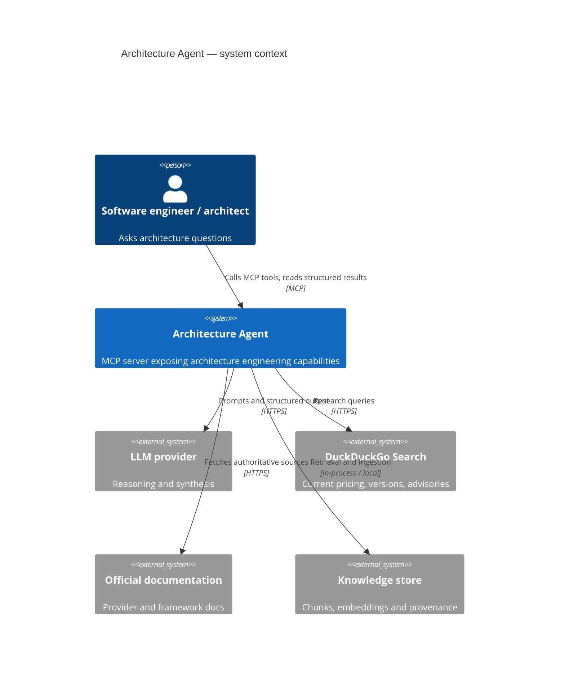

# Architecture Engineering Agent

An **MCP server** that provides software architecture, infrastructure, cloud,
deployment, security, cost and diagramming capabilities to engineering agents.

It is not a chatbot wrapper. It is an architecture engineering platform: every
recommendation carries its assumptions, trade-offs, evidence and confidence, and
every piece of retrieved information carries its provenance.

> **Status: Milestones 1–10 implemented, plus a container image and a Docker-based
> pipeline.** All 19 MCP tools from the specification are registered. Working offline: deterministic review, diagram generation, ADR drafting
> scaffolding and cost refusal. Model-backed design, comparison and estimation require
> a configured LLM provider and return a clear refusal when one is absent.
> See [`docs/roadmap.md`](docs/roadmap.md) for what is verified and what is not.

---

## Table of contents

- [What it does](#what-it-does)
- [Architecture at a glance](#architecture-at-a-glance)
- [Requirements](#requirements)
- [Setup](#setup)
- [Configuration](#configuration)
- [Development workflow](#development-workflow)
- [Testing](#testing)
- [Project layout](#project-layout)
- [Security posture](#security-posture)
- [Documentation](#documentation)

---

## What it does

Planned capabilities, mapped to the functional requirements in
[`docs/requirements.md`](docs/requirements.md):

| Capability | Requirement | MCP tool |
| --- | --- | --- |
| Analyse an existing architecture | FR-001 | `analyze_architecture` |
| Design a new architecture | FR-002 | `design_architecture` |
| Design internal infrastructure | FR-003 | `design_infrastructure` |
| Identify external dependencies | FR-004 | part of `analyze_architecture` |
| Provider-aware cloud design | FR-005 | `design_cloud_architecture` |
| Compare cloud services | FR-006 | `compare_cloud_services` |
| Estimate infrastructure cost | FR-007 | `estimate_cloud_cost` |
| Model budget scenarios | FR-008 | `analyze_budget` |
| Design deployment strategy | FR-009 | `design_deployment` |
| Design CI/CD pipelines | FR-010 | part of `design_deployment` |
| Security review | FR-011 | `security_review` |
| Reliability review | FR-012 | `reliability_review` |
| Scalability review | FR-013 | `scalability_review` |
| Observability analysis | FR-014 | `review_architecture` |
| UML and C4 diagrams | FR-015 | `generate_diagram` |
| Architecture Decision Records | FR-016 | `generate_adr` |
| Web research | FR-017 | `research_topic` |
| Knowledge retrieval | FR-018 | `search_architecture_knowledge` |
| Knowledge updates | FR-018 | `update_knowledge` |
| Structured reviews | FR-020 | `review_architecture` |

All nineteen tools are registered. Two work with no provider at all
(`review_architecture`, `generate_diagram`); the rest research, design and estimate,
and refuse with an actionable message when no LLM provider is configured.

## Architecture at a glance



Layering, dependency direction and the rationale behind each choice are in
[`docs/architecture.md`](docs/architecture.md). Decisions are recorded in
[`docs/adr/`](docs/adr/).

## Requirements

- Python 3.12 (3.13 supported; 3.14 not yet validated)
- [`uv`](https://docs.astral.sh/uv/) for environment and dependency management

Docker is optional and only needed for the container build.

## Setup

```bash
uv sync                      # create .venv and install dependencies
cp .env.example .env         # then edit .env
uv run python -c "from architecture_agent import get_settings; print(get_settings().environment)"
```

`.env` is gitignored. Never commit credentials.

## Configuration

All configuration is typed and lives in
`src/architecture_agent/config/settings.py`. Values come from the environment
with the `ARCH_AGENT_` prefix; nested sections use `__`.

| Variable | Default | Meaning |
| --- | --- | --- |
| `ARCH_AGENT_ENVIRONMENT` | `development` | Deployment environment label |
| `ARCH_AGENT_LOG_LEVEL` | `INFO` | Log level |
| `ARCH_AGENT_LOG_FORMAT` | `json` | `json` or `text` |
| `ARCH_AGENT_LLM__PROVIDER` | `anthropic` | `anthropic`, `openai`, `azure_openai`, `ollama`, `fake` |
| `ARCH_AGENT_LLM__MODEL` | `claude-sonnet-4-5` | Model identifier |
| `ARCH_AGENT_LLM__API_KEY` | *(unset)* | Provider key; falls back to the vendor env var |
| `ARCH_AGENT_SEARCH__PROVIDER` | `duckduckgo` | Research backend |
| `ARCH_AGENT_CACHE__*_TTL_SECONDS` | see `.env.example` | Freshness policy per data class |
| `ARCH_AGENT_KNOWLEDGE__DIRECTORY` | `.knowledge` | Local knowledge storage path |
| `ARCH_AGENT_MCP__TRANSPORT` | `stdio` | `stdio` or `streamable-http` |
| `ARCH_AGENT_SECURITY__ALLOWED_DOMAINS` | *(empty)* | Outbound fetch allowlist |

## Docker

Everything the image needs is in the repo. `docker build` produces the production
image; `--target test` produces one that runs the suite.

```bash
docker build -t architecture-agent:0.1.0 .          # production, 469 MB
docker build --target test -t architecture-agent:test .
docker run --rm architecture-agent:test             # 434 tests, inside the image

# stdio: an MCP client on the same host
docker run -i --rm architecture-agent:0.1.0

# HTTP: a container or a service
docker run -d --name aa -p 8000:8000 \
  -e ARCH_AGENT_MCP__TRANSPORT=streamable-http architecture-agent:0.1.0

# or all of the above with compose
docker compose -f infrastructure/docker/compose.yaml up -d
```

The image runs as UID 10001 with a read-only root filesystem, all capabilities
dropped and `no-new-privileges` (the compose file; a bare `docker run` does not set
those). `HEALTHCHECK` runs `python -m scripts.health_check`, which fails if the
security posture is wrong — so a compromised configuration takes the container out
of rotation instead of serving.

Verify a built image the way CI does:

```bash
./infrastructure/deployment/verify-image.sh architecture-agent:0.1.0
```

| Path | Purpose |
| --- | --- |
| `Dockerfile` | `base` → `deps` → `test`/`runtime`. `runtime` is the default target. |
| `.dockerignore` | Keeps local state and secrets out of the build context. |
| `infrastructure/docker/compose.yaml` | Local run: HTTP, health check, volume, hardening. |
| `infrastructure/deployment/README.md` | Deployment guide and a Kubernetes manifest. |
| `infrastructure/deployment/verify-image.sh` | The eight image gates CI runs. |

## CI/CD

`.github/workflows/ci.yml` runs six stages. Every gate after `build` runs against
the image, not the host checkout, so a Dockerfile that produces a broken image fails
the pipeline.

| Stage | Needs | Does |
| --- | --- | --- |
| `quality` | — | ruff format, ruff lint, mypy, `uv lock --check` |
| `contract` | quality | MCP contract snapshot, security boundary tests |
| `build` | quality | Builds `runtime`, exports it as an artifact |
| `test` | build | Runs the suite **inside** the image on 3.12 and 3.13, exports coverage |
| `verify` | build | `verify-image.sh`, hadolint, Trivy image scan, `pip-audit` |
| `publish` | all | Pushes multi-arch `linux/amd64,linux/arm64` to GHCR with SBOM and provenance |

Publishing runs only from `main` or a `v*` tag, and only after every gate passes.

## Development workflow

```bash
uv run ruff format .          # format
uv run ruff check --fix .     # lint and autofix
uv run mypy .                 # strict type check
uv run pytest                 # tests
uv run pytest --cov=architecture_agent --cov-report=term-missing
```

The MCP contract is snapshotted. Regenerate it deliberately:

```bash
uv run pytest tests/mcp --update-contracts
```

Pre-commit hooks wrap the same commands:

```bash
uv run pre-commit install
```

### Running the server

```bash
cp .env.example .env      # set ARCH_AGENT_LLM__API_KEY to enable model-backed tools
uv run python -m architecture_agent.mcp.server
```

Speaks stdio by default and logs JSON to stderr, leaving stdout for the protocol
alone. Set `ARCH_AGENT_MCP__TRANSPORT=streamable-http` to serve HTTP on
`127.0.0.1:8000`.

#### Connecting a client

Three shapes, and which one you want depends on where the client runs and
whether the server is already deployed.

| Shape | Command | Use when |
| --- | --- | --- |
| **Run from source** | `.venv/bin/python -m architecture_agent.mcp.server` | Developing; no build step |
| **Client spawns the container** | `docker run -i --rm <image>` | The client is on the same machine as the image |
| **Client talks to a deployed container** | `--url http://host:8000/mcp` | You deployed it; the client is anywhere |

For the first shape, use the project's virtualenv interpreter directly rather than
a `uv run` wrapper: the package is installed editable in `.venv`, so this works from
any working directory and starts in about a second. `uv run` needs the working
directory to be the project root and adds several hundred milliseconds per start.

All container shapes below were verified against this image: Claude Code reported
`✔ Connected`, OpenCode reported `✓ connected`, and Codex registered the server
with `transport: streamable_http`.

##### Claude Code

```bash
# A. client spawns the container (local config, private to you)
claude mcp add architecture-agent \
  -e ARCH_AGENT_LOG_LEVEL=WARNING \
  -- docker run -i --rm ghcr.io/architecture-agent/architecture_mcp:0.1.0

# B. share it with the team (.mcp.json, committed)
claude mcp add architecture-agent --scope project \
  -e ARCH_AGENT_LOG_LEVEL=WARNING \
  -- docker run -i --rm ghcr.io/architecture-agent/architecture_mcp:0.1.0

# C. a deployed container (HTTP): <name> then the URL, once each
claude mcp add architecture-agent --transport http \
  https://arch-agent.internal/mcp
```

Verify with `claude mcp get architecture-agent`. Expect `Status: ✔ Connected`.
A project-scoped server shows `⏸ Pending approval` until you accept it in a
session; run `claude` in the project directory and approve.

`--scope` defaults to `local` (stored in `~/.claude.json`, private to you). Use
`--scope project` to commit `.mcp.json` for the team, or `--scope user` for
every project on the machine.

##### Codex CLI

```bash
# A. client spawns the container
codex mcp add architecture-agent \
  --env ARCH_AGENT_LOG_LEVEL=WARNING \
  -- docker run -i --rm ghcr.io/architecture-agent/architecture_mcp:0.1.0

# B. a deployed container (HTTP)
codex mcp add architecture-agent --url https://arch-agent.internal/mcp
```

Writes to `~/.codex/config.toml`:

```toml
[mcp_servers.architecture-agent]
url = "https://arch-agent.internal/mcp"
```

or, for the container-spawning form:

```toml
[mcp_servers.architecture-agent]
command = "docker"
args = ["run", "-i", "--rm", "ghcr.io/architecture-agent/architecture_mcp:0.1.0"]

[mcp_servers.architecture-agent.env]
ARCH_AGENT_LOG_LEVEL = "WARNING"
```

Verify with `codex mcp list` (`Status: enabled`) and `codex mcp get <name>`.

##### OpenCode

`opencode mcp add` has no `--command` flag, so configure local servers in
`~/.config/opencode/opencode.json` (or `opencode.json` in a project):

```json
{
  "$schema": "https://opencode.ai/config.json",
  "mcp": {
    "architecture-agent": {
      "type": "local",
      "command": [
        "docker", "run", "-i", "--rm",
        "ghcr.io/architecture-agent/architecture_mcp:0.1.0"
      ],
      "environment": { "ARCH_AGENT_LOG_LEVEL": "WARNING" },
      "enabled": true
    },
    "architecture-agent-remote": {
      "type": "remote",
      "url": "https://arch-agent.internal/mcp",
      "enabled": true
    }
  }
}
```

Verify with `opencode mcp list`. It performs a real connection check and prints
`✓ connected` per server.

#### Before you deploy: the server has no authentication

This is the one thing to get right before exposing it.

The server **ignores `Authorization` headers and bearer tokens**. Codex's
`--bearer-token-env-var` and OpenCode's `--header` will happily send a credential
that nothing on the server ever checks. Do not rely on them to protect the
endpoint.

Put an authenticating reverse proxy in front of it:

```nginx
location /mcp {
    proxy_pass http://127.0.0.1:8000;
    proxy_http_version 1.1;
    proxy_set_header Host $host;
    proxy_set_header Upgrade $http_upgrade;      # required for streamable HTTP
    proxy_set_header Connection "upgrade";
    # Authenticate here: oauth2-proxy, an API gateway, mTLS, whatever you already run.
    auth_request /auth;
}
```

Terminate TLS at the proxy. The server speaks plain HTTP and does no
authentication, rate limiting or authorisation of its own. It is read-only, and it
holds whatever credential you gave it — so treat "read-only" as a limit on blast
radius, not as access control.

#### Where state is written

The knowledge base is a SQLite file at `ARCH_AGENT_KNOWLEDGE__DIRECTORY`, default
`.knowledge`. **A relative path resolves against the client's working directory**,
not the project root, because that is where an MCP stdio server is spawned. The
resolved absolute path is logged as `knowledge_directory` on startup, so check that
line rather than guessing. Set an absolute path to pin it:

```bash
-e ARCH_AGENT_KNOWLEDGE__DIRECTORY=/home/you/.local/share/architecture-agent/knowledge
```

### Readiness check

```bash
uv run python -m scripts.health_check
```

Prints one line per check and exits non-zero when the process is not ready to
serve traffic. Suitable as a container `HEALTHCHECK`.

## Testing

The suite is organised by concern so that the fast tiers stay fast:

| Directory | Scope |
| --- | --- |
| `tests/unit/` | Domain models, configuration, logging, validation |
| `tests/integration/` | Adapters against real or stubbed dependencies |
| `tests/mcp/` | MCP server contract: discovery, schemas, invocation, errors |
| `tests/e2e/` | Full scenarios from user request to structured answer |
| `tests/evaluation/` | AI evaluation dataset and scorers |
| `tests/security/` | Prompt injection, secret leakage, malformed input, diagram injection, permissions |
| `tests/performance/` | Latency, concurrency, cache effectiveness — **empty**, see [roadmap](docs/roadmap.md) |

No test requires network access or a provider credential. Tests that need an
LLM or a search backend use the `fake` provider.

## Project layout

```text
src/architecture_agent/
├── agent/         LangChain orchestration, prompts, policies   (Milestone 3)
├── application/   Use-case services orchestrating domain logic (Milestones 4-9)
├── config/        Typed settings and environment wiring
├── domain/        Pure models: architecture, cloud, cost, security, ...
├── infrastructure/Adapters: LLM, search, persistence, observability
├── knowledge/     Ingestion, chunking, retrieval, freshness     (Milestone 7)
├── mcp/           FastMCP server, tools, resources, prompts     (Milestone 2)
└── tools/         Tool implementations shared by MCP and agent (Milestones 4-9)
```

Dependencies point inwards: `domain` knows nothing, `application` depends on
`domain` and on infrastructure *protocols*, `mcp` and `agent` depend on
`application`. Infrastructure implements the ports.

## Security posture

- The agent is **read-only** in its first release: it reads, analyses,
  researches, designs, recommends and generates. It does not execute commands or
  modify infrastructure.
- Retrieved web content is treated as **untrusted data**, never as instructions.
  Instructions found in documents are recorded as evidence, not obeyed.
- Credentials are `SecretStr`, are never logged, and are scrubbed from log
  records and error messages at the logging boundary.
- Outbound fetching can be restricted with `ARCH_AGENT_SECURITY__ALLOWED_DOMAINS`.
- MCP errors are returned as structured, actionable messages; stack traces and
  secrets never cross the MCP boundary.

## Documentation

| Document | Contents |
| --- | --- |
| [`CLAUDE.md`](CLAUDE.md) | Operating instructions for coding agents on this repo |
| [`docs/requirements.md`](docs/requirements.md) | Functional and non-functional requirements |
| [`docs/architecture.md`](docs/architecture.md) | Layers, dependency rules, diagrams |
| [`docs/roadmap.md`](docs/roadmap.md) | Milestones, current status and what is not verified |
| [`docs/security.md`](docs/security.md) | Threat model, controls and deployment hardening |
| [`docs/testing.md`](docs/testing.md) | Test strategy and tiers |
| [`docs/adr/`](docs/adr/) | Architecture decision records |
| [`infrastructure/deployment/README.md`](infrastructure/deployment/README.md) | Container deployment, reverse proxy, Kubernetes manifest |
| [`coding-assistance/README.md`](coding-assistance/README.md) | AI-assisted development trace: agents, models and the full prompt log |

## License

MIT
