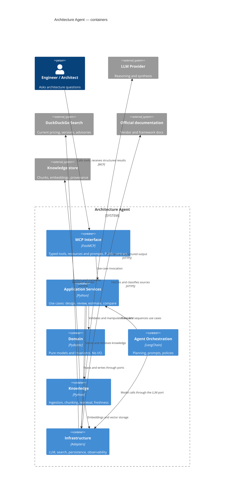
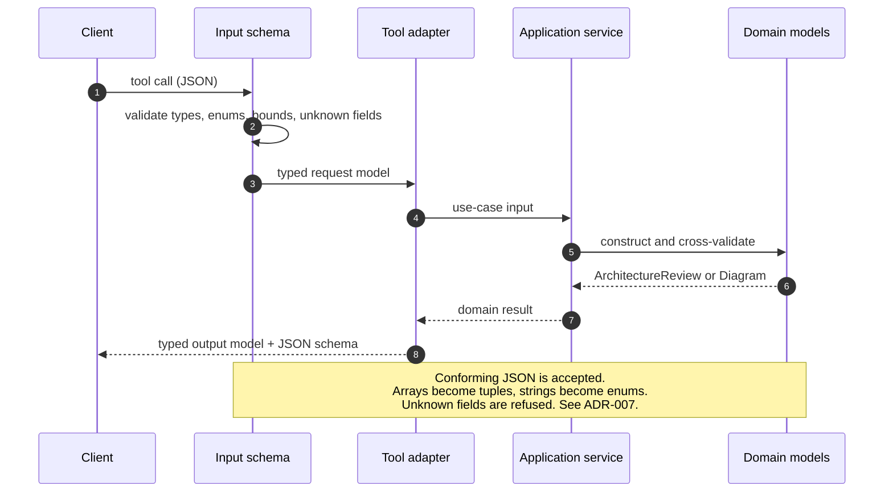
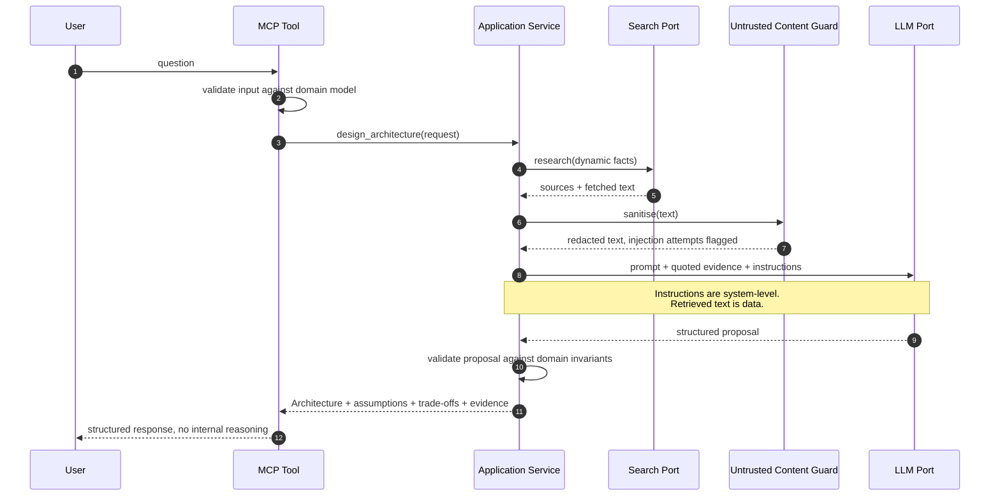

# Architecture

How the system is put together, why, and where the boundaries are.

Diagrams are Mermaid so they render in the repository without a build step.

---

## 1. Principles

1. **The domain decides; adapters fetch.** Anything that knows about AWS, an LLM
   vendor or a database engine lives in `infrastructure/`. The domain knows about
   architectures.
2. **Dependencies point inwards.** `mcp`, `agent` and `tools` may depend on
   `application`; `application` may depend on `domain`; `domain` depends on
   nothing of ours.
3. **Ports in the inner layer, adapters in the outer.** `application` declares the
   protocols it needs (`LLMClient`, `SearchClient`, …). `infrastructure` provides
   them. Neither side waits for the other.
4. **Untrusted data never becomes an instruction.** Retrieved content enters the
   system as a value, is redacted and classified, and is quoted — never parsed as
   a command.
5. **No speculation.** An abstraction exists because a requirement needs two
   implementations, not because one might appear later.

## 2. Container view

## 3. Layers and allowed imports

| Layer | Package | May import | Must never import |
| --- | --- | --- | --- |
| Domain | `domain/` | `pydantic`, stdlib | anything from this project except `domain` |
| Application | `application/` | `domain`, stdlib, ports declared locally | concrete adapters |
| Presentation | `mcp/`, `tools/`, `agent/` | `application`, `domain`, ports | adapter internals |
| Adapters | `infrastructure/` | `domain`, ports, third-party SDKs | `mcp`, `agent`, `tools` |
| Knowledge | `knowledge/` | `domain`, stdlib | `application`, `mcp`, `tools` |
| Cross-cutting | `config/`, `infrastructure/observability/` | stdlib, `pydantic`, `pydantic-settings` | — |

### Declared ports

| Port | Declared in | Implemented by | Purpose |
| --- | --- | --- | --- |
| `LLMClient` | `application/llm_service.py` | `infrastructure/llm/` | Model access without a vendor dependency |
| `SearchClient` | `application/research_service.py` | `infrastructure/search/` | Finding candidate URLs |
| `PageFetcher` | `application/research_service.py` | `infrastructure/search/` | Retrieving document text |
| `DiagramRenderer` | `application/diagram_service.py` | `infrastructure/rendering/` | Producing diagram syntax |
| `Embedder` | `knowledge/embeddings.py` | `knowledge/embeddings.py` | Turning text into vectors |
| `VectorStore` | `knowledge/storage.py` | `knowledge/storage.py` | Storing and retrieving chunks |

Every one of these has at least two implementations, or one implementation plus a
documented reason it is the only one. That is the test ADR-001 applies before a port
is allowed to exist.

The direction to police is `infrastructure → mcp/agent/tools`: an adapter must not
know it is being called over MCP. That is what makes the LLM and search layers
testable outside a server.

### Why ports live with the use case

A port declared next to the use case that needs it keeps the interface minimal. If
`design_architecture` needs an LLM and a research client, `application/design.py`
declares exactly those two protocols. Adding a cache later means widening one
existing protocol or adding one port — never editing an interface other code
implements.

## 4. Domain map

```mermaid
classDiagram
    class Architecture {
        +str name
        +ArchitectureStyle style
        +tuple~SystemComponent~ components
        +tuple~Interaction~ interactions
        +tuple~ExternalDependency~ external_dependencies
        +tuple~Assumption~ assumptions
        +tuple~TradeOff~ trade_offs
    }
    class SystemComponent {
        +str name
        +ComponentKind kind
        +str responsibility
        +tuple~str~ technology
        +bool is_external
    }
    class Interaction {
        +str source
        +str target
        +str protocol
        +bool synchronous
    }
    class ExternalDependency {
        +str name
        +ExternalDependencyRisk risk
        +bool sla_known
    }
    class InfrastructurePlan {
        +tuple~ComputeUnit~ compute
        +tuple~NetworkSegment~ network
        +tuple~StorageUnit~ storage
        +tuple~DatabaseUnit~ databases
        +ObservabilityStack observability
        +AvailabilityObjective availability
    }
    class CostEstimate {
        +Currency currency
        +tuple~CostComponent~ components
        +tuple~str~ assumptions
        +ConfidenceLevel confidence
        +monthly_total() Decimal
        +annual_total() Decimal
        +bounds() tuple
        +is_stale() bool
    }
    class ArchitectureReview {
        +tuple~DimensionScore~ scores
        +tuple~ReviewFinding~ findings
        +tuple~str~ evidence_gaps
        +overall_score() float
    }
    class SourceDocument {
        +HttpUrl url
        +SourceTier tier
        +ConfidenceLevel confidence
        +KnowledgeCategory category
        +datetime retrieved_at
        +str content_hash
    }
    class ResearchResult {
        +ResearchRequest request
        +tuple~SourceDocument~ sources
        +bool degraded
        +best_confidence() ConfidenceLevel
    }

    Architecture "1" *-- "1..*" SystemComponent
    Architecture "1" *-- "0..*" Interaction
    Architecture "1" *-- "0..*" ExternalDependency
    Architecture "1" *-- "0..*" Assumption
    Architecture "1" *-- "0..*" TradeOff
    InfrastructurePlan "1" *-- "1" ObservabilityStack
    InfrastructurePlan "1" *-- "1" AvailabilityObjective
    CostEstimate "1" *-- "1..*" CostComponent
    ArchitectureReview "1" *-- "1..*" DimensionScore
    ArchitectureReview "1" *-- "0..*" ReviewFinding
    ResearchResult "1" *-- "1" ResearchRequest
    ResearchResult "1" *-- "0..*" SourceDocument
```

`SourceDocument` and `ResearchResult` carry evidence for every other model: a
`CostEstimate` without `PricingReference`, or a `ReviewFinding` without evidence,
is a claim rather than an assessment.

## 4a. MCP request flow

Three layers decide what a client sees:

| Layer | Owns |
| --- | --- |
| `tools/schemas.py` | The published JSON Schema: names, types, bounds, `additionalProperties: false` |
| `application/errors.py` | Whether a failure is actionable (returned) or opaque (masked) |
| `mcp/tools.py` | Mapping input to a use case, shaping output, converting errors |

`mcp/server.py` is the composition root and the only module that builds
dependencies.

## 5. Untrusted data flow

The single most important sequence in the system.

Rules enforced by the domain and by tests:

- Retrieved text is passed as **quoted data**, never concatenated into an
  instruction slot.
- An instruction-shaped string inside retrieved content is recorded as evidence
  (`injection_attempts`) and never executed.
- Output is re-validated before it leaves the application layer. A model cannot
  emit an architecture whose interactions reference unknown components.

## 6. Error model

| Situation | Behaviour |
| --- | --- |
| Invalid tool input | Rejected by the domain model before any I/O; error names the offending field |
| LLM timeout or provider error | Raise a typed error; the tool layer converts it to a structured message |
| Search unavailable | `ResearchResult(degraded=True, degradation_reason=...)` — the answer continues with the evidence it has |
| LLM returned malformed output | Retried once with a stricter schema, then reported as a failure; never partially accepted |
| Secrets anywhere in a payload | Redacted at the logging boundary and at the MCP response boundary |

Stack traces and secret values never cross the MCP boundary.

## 7. Performance shape

| Operation | Cache key | Default TTL |
| --- | --- | --- |
| Web search | normalised query + provider | 1 hour |
| Pricing retrieval | provider + service + region | 6 hours |
| Knowledge retrieval | query + top-k | 24 hours |
| LLM call | never | — |

`CacheSettings` already carries the four TTLs; the cache implementation arrives
with the research layer (Milestone 6). Pricing TTLs are short because prices
change; knowledge TTLs are long because chunks are immutable once hashed.

## 8. Deliberate deviations from the specification's tree

| Deviation | Reason |
| --- | --- |
| `infrastructure/observability/` instead of a top-level `observability/` | Logging is a cross-cutting technical concern; §3 of `CLAUDE.md` reserves `infrastructure/` for those. ADR-006 |
| Logging settings are flat (`ARCH_AGENT_LOG_LEVEL`) rather than nested | Avoids `ARCH_AGENT_OBSERVABILITY__LEVEL` for the most frequently tuned knob |
| ADR domain model lives in `domain/architecture.py` | An ADR *is* an architecture artefact; a separate module would be one file with one class |
| `knowledge/` and `agent/` have no code yet | Milestones 3, 6 and 7; documented stub packages only |
| Renderers live in `infrastructure/rendering/`, not `application/` | Syntax is presentation. The diagram use case declares the `DiagramRenderer` port it needs, per ADR-001 |
| `DiagramRenderer.language` must equal a `DiagramLanguage` value | The domain has a closed set of output languages; a new syntax needs a new enum member before it can be registered |

## 9. Related documents

- [`requirements.md`](requirements.md) — requirement traceability
- [`roadmap.md`](roadmap.md) — milestone status
- [`security.md`](security.md) — threat model and controls
- [`testing.md`](testing.md) — test tiers
- [`adr/`](adr/) — decision records
